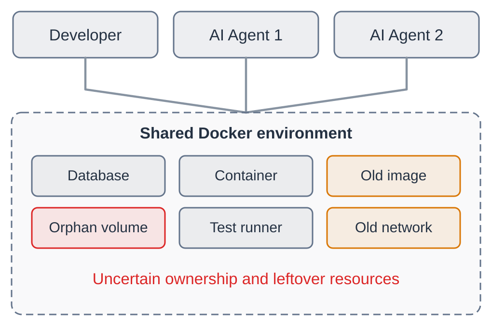
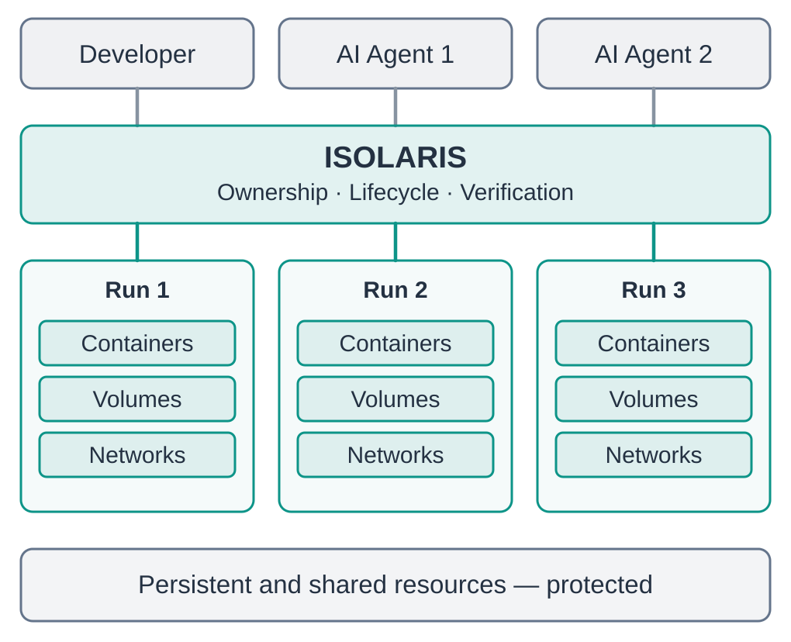
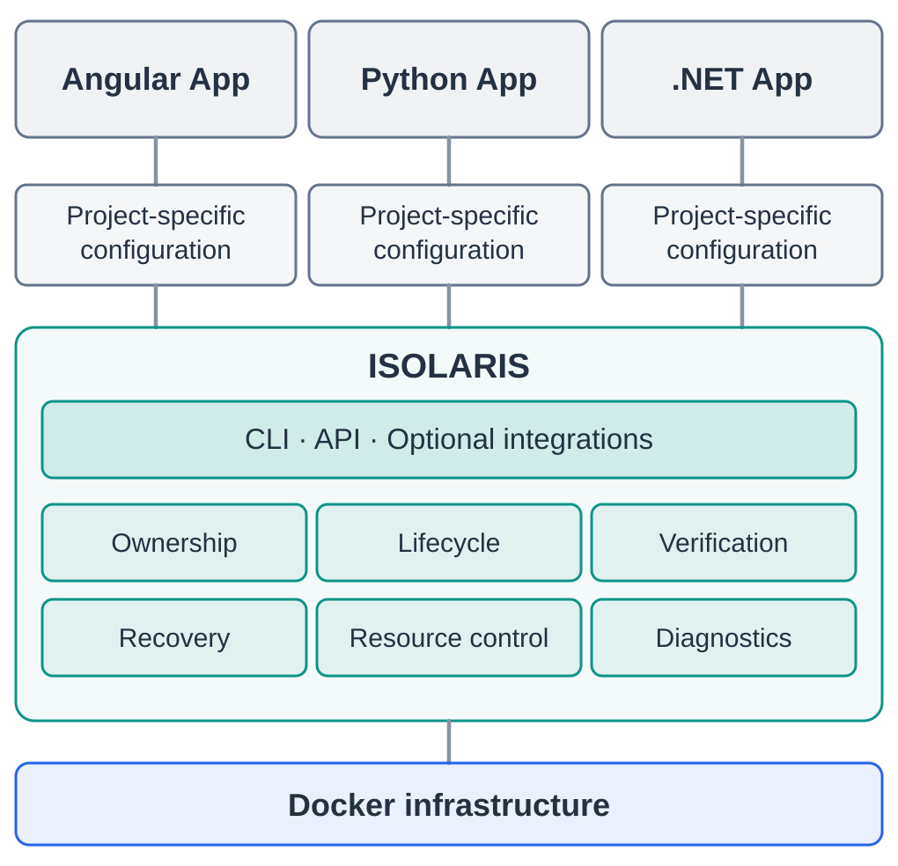
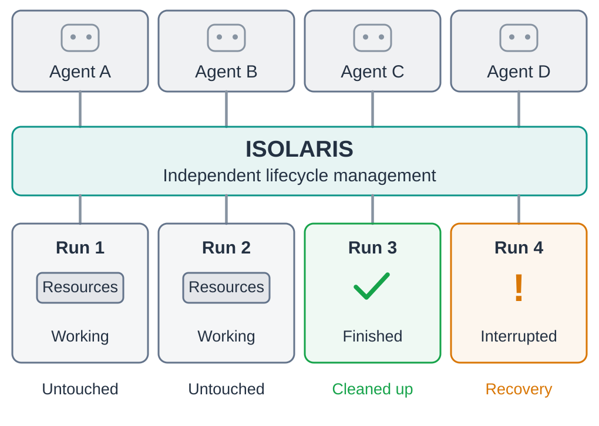

# Isolaris

**Isolation by design. Integrity by default.**

Isolaris is a security-first infrastructure framework for accountable container lifecycle management, designed for software development, automated testing, CI/CD and autonomous coding agents.

Its central idea is simple: every temporary execution environment should have a clearly defined owner, a controlled lifecycle and a verifiable outcome. Infrastructure should be created for a purpose, used within its intended boundaries and safely cleaned up when that purpose is fulfilled.

## Why Isolaris?

Containerized environments make software development and testing more reproducible. Managing those environments across repeated executions, parallel workloads and interrupted processes, however, introduces a different set of challenges.

- Temporary containers, images, networks and volumes can accumulate over time.
- Concurrent workloads can interfere with one another or compete for shared resources.
- Failed or interrupted executions can leave environments in an uncertain state.
- Broad cleanup operations can unintentionally affect persistent data and unrelated workloads.
- Infrastructure management can become fragmented across project-specific scripts.
- Increasing automation makes it more important to establish clear responsibility for the resources created during each execution.

Isolaris aims to provide a consistent lifecycle management layer that addresses these challenges without sacrificing security, developer productivity or operational reliability.

## Container lifecycle management with Isolaris

### Without structured lifecycle management

Independent developers and agents may share the same Docker infrastructure. Without a consistent ownership and lifecycle model, interrupted executions can leave resources behind and make safe cleanup difficult.

### With Isolaris

Each managed execution has its own identity and resource ownership boundary. Temporary resources can be handled independently, while shared and persistent infrastructure remains protected.

*Conceptual comparison. Managed resource ownership is not a security sandbox for hostile workloads.*

## Core objectives

| Area | Design objective |
| --- | --- |
| Resource ownership | Establish clear responsibility for resources associated with each managed execution. |
| Isolated execution | Reduce interference between independent environments and concurrent workloads. |
| Lifecycle management | Provide a consistent approach to environment creation, execution, shutdown and disposal. |
| Verified cleanup | Treat cleanup as an outcome to be verified, rather than simply a command to be executed. |
| Resource protection | Preserve persistent data, shared infrastructure and resources belonging to unrelated workloads. |
| Controlled recovery | Support safe investigation and recovery of abandoned or interrupted environments. |
| Operational transparency | Make lifecycle outcomes, failures and unresolved resources understandable to developers and operators. |
| Resource efficiency | Reduce unnecessary accumulation of temporary infrastructure while preserving legitimate reuse. |
| Reusability | Provide a common infrastructure foundation independent of application language, framework or business domain. |

## Conceptual architecture

Isolaris is designed to provide a common infrastructure layer for unrelated applications. Each application defines its own environment requirements, while the reusable framework manages the infrastructure lifecycle independently of the application's language or business logic.

*Different applications, one reusable infrastructure framework. The diagram describes conceptual responsibilities rather than a finalized implementation.*

## The lifecycle

The Isolaris lifecycle model is organized around six responsibilities:

1. **Prepare** — establish the intended execution environment and its boundaries.
2. **Create** — provision the infrastructure required for the workload.
3. **Execute** — run the workload within its defined environment.
4. **Dispose** — safely release temporary resources belonging to that execution.
5. **Verify** — establish whether the lifecycle has completed as intended.
6. **Recover** — investigate and resolve incomplete lifecycle outcomes when necessary.

A successful workload and a successfully completed infrastructure lifecycle are distinct outcomes. Isolaris treats both as important.

## Who is Isolaris for?

### Software developers

A consistent approach to temporary local environments, integration tests and reproducible development workflows, without requiring every application to maintain its own lifecycle tooling.

### DevOps and platform engineering teams

A reusable foundation for predictable infrastructure behavior, operational accountability and resource management across multiple projects.

### CI/CD pipelines

Controlled, repeatable execution environments for builds, validation and automated tests, with particular attention to failure handling, concurrency and cleanup.

### Automated testing

Independent test environments that support reliable execution while protecting persistent development infrastructure and other test workloads.

### Autonomous AI and coding agents

A structured infrastructure lifecycle for agents that create and use temporary environments, with an emphasis on resource responsibility, predictable behavior and safe coexistence with other workloads.

#### Concurrent agent execution

The following example illustrates four agents working independently on a shared host. Two continue working, one completes its workload and another is interrupted. Lifecycle management should distinguish their resources and handle each outcome independently.

The completed run can undergo verified cleanup, while the interrupted run requires safe investigation and recovery. Neither operation should disturb the two active workloads. Uncertain resources must be preserved until safe recovery is established.

*This model assumes appropriately trusted execution and container access. It does not provide a sandbox for untrusted agents.*

## Design philosophy

- **Security first.** Convenience, speed and automation must not come at the expense of resource safety.
- **Explicit ownership.** Temporary infrastructure should have a defined lifecycle and a clear scope of responsibility.
- **Conservative cleanup.** Uncertain ownership is a reason for caution, not permission to remove resources.
- **Verification over assumptions.** Successful operations should be supported by meaningful evidence.
- **Predictability.** Failures and interruptions should have clear, understandable outcomes.
- **Separation of concerns.** Infrastructure lifecycle management should remain independent of application-specific logic.
- **Simplicity through reuse.** Projects should be able to share a consistent infrastructure foundation rather than repeatedly implementing the same responsibilities.

## Relationship to container tooling

Isolaris is designed to complement established container tooling, with Docker-based workflows as its initial focus.

Container engines and orchestration tools provide the capabilities to build, start, connect and stop workloads. Isolaris focuses on the responsibilities surrounding those operations: ownership, lifecycle accountability, safe disposal and recovery.

It is not intended to replace a container engine, a production orchestrator, a CI/CD platform or an application testing framework. Its purpose is to provide a reusable lifecycle management layer across those workflows.

## Security scope

Isolaris focuses on the safe management of temporary execution infrastructure. It is not a substitute for host security, operating system isolation, access control or dedicated sandboxing of untrusted workloads. Access to container infrastructure must be governed by an appropriate trust and permission model.

## Project scope

This README describes the project's vision, intended capabilities and design principles. It is not a specification of implemented features, supported platforms or security guarantees.
